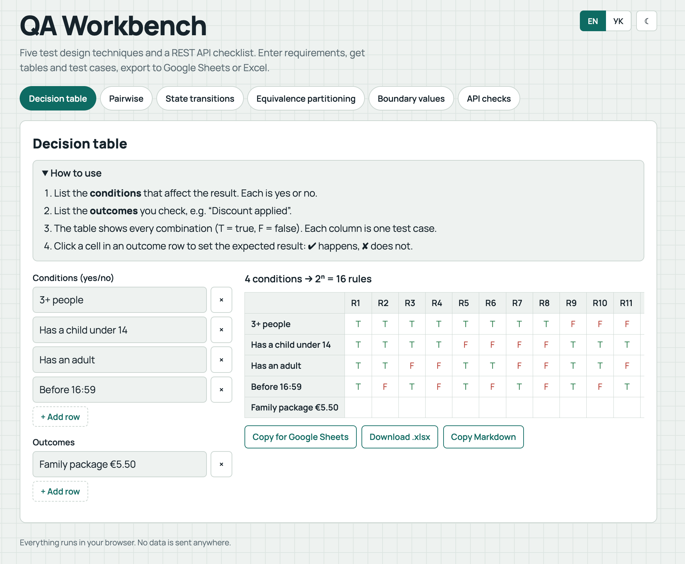

# QA Workbench

A small browser tool for practicing test design. Enter a requirement, get decision tables, pairwise sets, state diagrams, equivalence classes, boundary values and a REST API checklist. Export any result to Google Sheets, Excel or Markdown.

**Live demo:** https://yurchykd.github.io/qa-workbench

## What it does

| Tab | What you get |
|---|---|
| Decision table | All 2ⁿ combinations of yes/no conditions, with clickable outcome cells |
| Pairwise | The smallest set of tests that covers every pair of parameter values |
| State transitions | A diagram from transition rows, plus a state × event table that exposes negative tests |
| Equivalence partitioning | Valid and invalid classes for a numeric field, with an explanation for each class |
| Boundary values | 2-value or 3-value analysis, with the bug each value is meant to catch |
| API checks | A REST checklist built from the method and path (statuses, headers, body, negative, auth, pagination) with a “how to test” hint per case |

The API checklist is a reference. Your API documentation or contract is always the source of truth.

## Features

- English and Ukrainian interface
- Light and dark theme
- Copy any table for Google Sheets, download it as `.xlsx`, or copy it as Markdown
- Built-in “How to use” instructions on every tab
- Responsive layout, works on mobile
- No backend, no build step, no tracking: everything runs in the browser

## Run locally

Open `index.html` in a browser. That is all.

## Tech

Plain HTML, CSS and JavaScript in a single file. [SheetJS](https://sheetjs.com/) is loaded from cdnjs for `.xlsx` export, and Manrope from Google Fonts.

## Notes

This is a learning project. Pairwise uses a greedy algorithm, so the set is small but not always the mathematically minimal one. The state diagram uses a simple circular layout, so very large diagrams can get crowded.

---

## Українською

**QA-майстерня**: навчальний інструмент для тест-дизайну. Вводите вимоги й отримуєте таблицю рішень, pairwise, діаграму станів, класи еквівалентності, граничні значення та чекліст перевірок для REST API. Результат можна скопіювати в Google Таблиці, завантажити як `.xlsx` або скопіювати як Markdown. Інтерфейс доступний українською та англійською.
